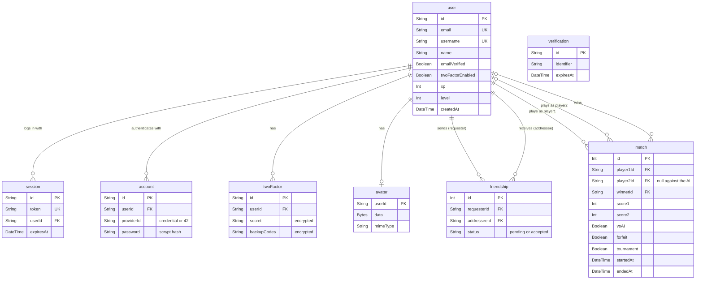

*This project has been created as part of the 42 curriculum by mosmond, aandreo, abensaid, TODO, TODO.*

# Pongo

> Our take on the 42 **ft_transcendence** subject.

## Description

**Pongo** is a web application where players compete in **Pong**: local 1v1, against an AI, online in real time, or in tournaments. It includes user accounts, profiles, friends, statistics and a leaderboard, in several languages.

> **Status:** full stack running in Docker: accounts (email/password, 42 OAuth, 2FA), profiles and friends, local / AI / online Pong, tournaments, spectator mode, monitoring with Prometheus and Grafana. See [`docs/`](docs/) for details (in French).

A preview of the front-end is deployed on **Vercel**: TODO add URL.

## Instructions

### Requirements

- **For the full stack (evaluation):** Docker Engine with the Compose plugin (`docker compose`). Tested with Compose 2.40. No other tool is needed: the images install Bun, PostgreSQL, nginx and the monitoring tools themselves.
- **For development only:** [Bun](https://bun.sh) ≥ 1.2 (the CI uses 1.4.4).

### Run locally (development)

```bash
bun install
bun run dev
```

Open <http://localhost:3000>: you are redirected to `/en` or `/fr`.

### Production build

```bash
bun run build
bun run start
```

### Full stack with Docker (evaluation setup)

1. **Create the `.env` file** from the template, at the root of the repository. It is ignored by Git and holds every credential.

   ```bash
   cp .env.example .env
   ```

   Then fill it in:

   | Variable | Required | What to put |
   | --- | --- | --- |
   | `POSTGRES_USER`, `POSTGRES_PASSWORD`, `POSTGRES_DB` | yes | Any values: the database is created with them |
   | `BETTER_AUTH_SECRET` | yes | A random secret: `openssl rand -base64 32` |
   | `GRAFANA_ADMIN_USER`, `GRAFANA_ADMIN_PASSWORD` | yes | Login of the Grafana dashboards |
   | `HTTPS_PORT`, `HTTP_PORT` | no | Defaults `8443` and `8080` (the rootless Docker of the 42 computers cannot open ports below 1024) |
   | `FT_CLIENT_ID`, `FT_CLIENT_SECRET` | no | Keys of the 42 intra application, for "Continue with 42". Redirect URI: `https://localhost:8443/api/auth/callback/42` |
   | `SEED_PASSWORD` | no | Password of the test accounts created by the seed (8+ characters, a letter and a digit) |

   If a required variable is missing, `docker compose` refuses to start and names it.

2. **Start everything with one command:**

   ```bash
   docker compose up --build
   ```

   The first build takes a few minutes. At start-up the app applies the database migrations by itself.

3. **Open the site:** <https://localhost:8443>. The certificate is self-signed (generated when the nginx image is built), so the browser shows a warning: choose "Advanced" then "Proceed to localhost". `http://localhost:8080` redirects to HTTPS.

4. **Optional: test accounts.** With `SEED_PASSWORD` set, this creates 3 players (`alice@42.fr`, `bob@42.fr`, `charlie@42.fr`), friendships and a match history:

   ```bash
   docker compose exec -e ALLOW_SEED=1 app bun prisma/seed.ts
   ```

5. **Monitoring:** <https://localhost:8443/grafana/>, with `GRAFANA_ADMIN_USER` / `GRAFANA_ADMIN_PASSWORD`. Dashboards → Pongo → "Pongo - vue d'ensemble".

Stop with `docker compose down`. `docker compose down -v` also deletes the data (database, Prometheus history, Grafana). The Grafana password is only applied when its volume is first created: after changing it in `.env`, remove the volume with `docker compose down -v`.

#### What runs

Only nginx is reachable from the host. Every other service is on the internal Docker network and is reached by its service name (`db`, `app`, `prometheus`...).

```text
Browser ──HTTPS :8443──► nginx ──► app:3000 (Next.js pages + API, Socket.IO game server)
                           │          └──► db:5432 (PostgreSQL, volume db_data)
                           └──► /grafana/ ──► grafana:3000 ──► prometheus:9090
                                                                  ├── app:3000/metrics
                                                                  ├── postgres-exporter:9187
                                                                  ├── node-exporter:9100
                                                                  └── cadvisor:8080
```

| Service | Image | Role |
| --- | --- | --- |
| `nginx` | built from `nginx/` | HTTPS (TLS 1.2/1.3), reverse proxy, WebSocket upgrade, HTTP → HTTPS redirect, security headers, hides `/metrics` |
| `app` | built from `Dockerfile` | Multi-stage production build (`next build`, then `bun server.ts`), runs as a non-root user, applies migrations at start-up |
| `db` | `postgres:15` | Database, with a `pg_isready` health check |
| `prometheus` | `prom/prometheus:v3.16.0` | Collects metrics every 15 s and evaluates the alert rules |
| `postgres-exporter` | `prometheuscommunity/postgres-exporter:v0.21.1` | Database metrics |
| `node-exporter` | `prom/node-exporter:v1.13.1` | Machine metrics (CPU, RAM, disk, network) |
| `cadvisor` | `ghcr.io/google/cadvisor:v0.61.1` | CPU / RAM per container |
| `grafana` | `grafana/grafana:13.3.2` | Dashboards, served under `/grafana/` |

Start order is driven by health checks: the app waits for a healthy database, nginx waits for a healthy app (no 502 errors at start-up).

### Continuous integration

Every push to `main` or `devops/infra-base`, and every pull request to `main`, runs `.github/workflows/ci.yml`: install with the frozen lockfile, ESLint, `next typegen` + TypeScript type check, production build.

## Team information

| Login | Role(s) | Responsibilities |
| --- | --- | --- |
| mosmond | TODO (PO / PM / Tech Lead / Dev) | Front-end: pages, i18n, SSR, browsers |
| aandreo | Developer | Auth & users: accounts, OAuth 42, 2FA, friends |
| abensaid | Developer | DevOps: Docker / Docker Compose, nginx HTTPS, Prisma (schema, migrations, seed), CI, monitoring (Prometheus, exporters, Grafana, alerts) |
| TODO | TODO | Game engine: Pong, remote players, spectator mode |
| TODO | TODO | Around the game: AI, stats, tournament, customization, gamification |

## Project management

TODO: how tasks were split and tracked, communication tools, meeting rhythm.

## Technical stack

| Layer | Technology | Why |
| --- | --- | --- |
| Framework | **Next.js 16** (App Router) + React 19 | Front and back in one project (Route Handlers / Server Actions), server-side rendering |
| Styling | **Tailwind CSS v4** + **shadcn/ui** (base-ui) | CSS framework required by the subject; accessible, editable components |
| i18n | **next-intl** | Localized routes (`/en`, `/fr`), server and client translations |
| Validation | **zod** | One schema shared by the front-end and the back-end |
| 3D | **three.js** | Cel-shaded animated intro of the home page only, loaded on demand |
| Real time | Socket.IO on a custom server (`server.ts`) | Server-authoritative Pong at ~60 ticks/s |
| Database | PostgreSQL + Prisma 7 | Relational data (users, friends, matches) with a typed ORM |
| Auth | Better Auth | Email/password with unique usernames, OAuth 2.0 with 42, TOTP 2FA |
| Infra | Docker Compose, nginx (HTTPS) | Single-command launch, one HTTPS entry point for the site, the game WebSocket and Grafana |
| Monitoring | Prometheus, postgres-exporter, node-exporter, cAdvisor, Grafana, prom-client | Metrics of the app, the database, the machine and each container; dashboards and alerts |
| CI | GitHub Actions | Lint, type check and build on every push and pull request |
| Package manager | **Bun** | Fast installs and scripts |
| Preview hosting | **Vercel** | Front-end preview only (no custom server / WebSockets there) |

## Database schema

PostgreSQL 15, accessed through **Prisma 7** (`prisma/schema.prisma`, migrations in `prisma/migrations/`). The first five tables are the ones Better Auth needs; the others are ours. Table names are lowercase (`@@map`).



| Table | Content | Relations |
| --- | --- | --- |
| `user` | Account, unique email and username, XP and level | Parent of every other table |
| `session` | One row per logged-in browser (cookie token) | `user` 1-n, deleted with the user |
| `account` | A way to log in: `credential` (email + hashed password) or `42` (OAuth tokens) | `user` 1-n |
| `verification` | Short-lived tokens (email verification, password reset) | none |
| `twoFactor` | TOTP secret and backup codes, encrypted by Better Auth | `user` 1-n |
| `avatar` | Uploaded picture (stored in the database: no file volume needed) | `user` 1-1 |
| `friendship` | Friend request, `pending` then `accepted`; one row per pair (`@@unique`) | 2 links to `user` |
| `match` | Finished online match: players, score, winner, forfeit, tournament flag, dates | 3 links to `user` (player 1, player 2, winner) |

Deleting a user deletes their sessions, accounts, friendships and matches (`onDelete: Cascade`); a deleted winner only clears `winnerId` (`SetNull`). Foreign keys used for lookups are indexed. Tournaments in progress live in the game server's memory; only their matches are saved.

## Features list

| Feature | Status | Who |
| --- | --- | --- |
| Localized pages (EN/FR) with language switcher | Done | mosmond |
| Home, play menu | Done | mosmond |
| Profiles (own + public), avatar upload, friends with online status, leaderboard (from the database) | Done | aandreo, TODO |
| 2FA (TOTP + backup codes) and login with 42 (OAuth 2.0) | Done | aandreo, TODO |
| Sign up / log in (Better Auth, validated client- and server-side) | Done | mosmond, aandreo |
| Change password on the settings page (validated client- and server-side) | Done | aandreo |
| Privacy Policy and Terms of Service (footer links) | Done | mosmond |
| Local 1v1 Pong (canvas) | Done | mosmond |
| Swiss visual identity, light/dark theme, "Stack" logo | Done | mosmond |
| Animated manga-style 3D intro on the home page (full once per session, short version on reload) | Done | mosmond |
| Online games (server-side, reconnection, spectators), tournaments, saved results + XP | Done | TODO |
| One-command Docker stack, HTTPS through nginx, `.env` / `.env.example` | Done | abensaid |
| Database: first schema, migrations workflow, test seed (Prisma) | Done | abensaid, TODO (auth and game tables) |
| Continuous integration (lint, type check, build) | Done | abensaid |
| Monitoring: `/metrics`, Prometheus, exporters, Grafana dashboard, alert rules | Done | abensaid |
| AI opponent | TODO | TODO |

## Modules

Target: **23 points** (19 needed for 125 %).

| Module | Type | Points | Owner | Status |
| --- | --- | --- | --- | --- |
| Framework front + back (Next.js) | Major | 2 | All | In progress |
| ORM (Prisma) | Minor | 1 | DevOps | Done |
| Monitoring (Prometheus + Grafana) | Major | 2 | DevOps | Done |
| Standard user management | Major | 2 | Auth & users | Done (profile edit, avatar upload, friends, online status) |
| Remote authentication (OAuth 2.0, 42) | Minor | 1 | Auth & users | Done (needs a 42 intra app) |
| Two-factor authentication (TOTP) | Minor | 1 | Auth & users | Done |
| Web-based game (Pong 2D) | Major | 2 | Game engine | Local preview |
| Remote players (+ reconnection) | Major | 2 | Game engine | Done |
| Spectator mode | Minor | 1 | Game engine | Done |
| AI opponent | Major | 2 | Around the game | TODO |
| Game statistics and match history | Minor | 1 | Around the game | Done |
| Tournament system | Minor | 1 | Around the game | Done |
| Game customization | Minor | 1 | Around the game | TODO |
| Gamification | Minor | 1 | Around the game | TODO |
| Multiple languages (3) | Minor | 1 | Front | EN/FR done, 3rd TODO |
| Server-Side Rendering | Minor | 1 | Front | Done (all pages pre-rendered per locale) |
| Additional browsers (Firefox + Edge) | Minor | 1 | Front | TODO |
| **Total** | | **23** | | |

### DevOps modules: why and how

**ORM — Prisma 7 (Minor, 1 pt).** *Why:* typed queries checked by TypeScript, a schema file that documents the database, and versioned migrations that every teammate and the Docker container apply the same way. *How:* `prisma/schema.prisma` describes the tables and relations; `prisma migrate dev` creates a migration in development, and the container runs `prisma migrate deploy` before starting the server. The client is generated in `lib/generated/prisma` and uses the `pg` driver through `@prisma/adapter-pg` (Prisma 7 has no Rust query engine). `prisma/seed.ts` creates test data, refuses to run in production unless `ALLOW_SEED=1`, and reads the test password from `.env`.

**Monitoring — Prometheus + Grafana (Major, 2 pts).** *Why:* a real-time game must be watched while it runs: is the app up, is the database reachable, are the machine and each container running out of CPU or RAM, how many players are connected. *How:*
- **Collect metrics:** `server.ts` exposes `/metrics` with `prom-client` (process CPU / RAM + the custom gauge `pongo_connected_players`). Prometheus reads it every 15 s on the internal network; nginx answers 404 to `/metrics` from outside.
- **Exporters:** `postgres-exporter` (database), `node-exporter` (machine), `cAdvisor` (per container).
- **Custom dashboard:** `grafana/dashboards/pongo-overview.json`, loaded automatically with its Prometheus data source (provisioning): service status, connected players, app CPU / RAM, machine CPU / RAM with the alert threshold, database connections, CPU / RAM per container, number of firing alerts.
- **Alert rules:** `prometheus/alerts.yml`: `AppDown` (`up == 0` for 30 s), `PostgresDown` (`pg_up == 0` for 30 s), `HighMemoryUsage` (RAM > 85 % for 1 min). Visible in Prometheus and on the dashboard. Demo: `docker compose stop app`, the alert is firing after about 40 s.
- **Secured access:** Grafana has no published port and is only reachable through nginx over HTTPS, under `/grafana/`; admin login from `.env`, sign-up and anonymous access disabled.

## Individual contributions

- **mosmond** — Front-end rebuild: Next.js 16 App Router structure, next-intl (EN/FR, localized routing via `proxy.ts`), shadcn/ui components, all pages, shared zod validation schemas, local canvas Pong, Privacy/ToS pages; Swiss visual identity with light/dark theme and the "Stack" logo; the animated 3D intro of the home page (three.js) and the `/templates` style lab.
- **aandreo** — Auth & users. Added the change-password form on the settings page, with a zod schema shared by the form and the server (`lib/validation/auth.ts`, re-validated in `lib/auth.ts`). Registered the 42 intra application and set up OAuth login. Made the development database port configurable (`DB_PORT`). Tested the whole module: sign up, log in, sessions, 2FA, login with 42, profile edit, avatar upload, friends and online status, in development, in production and in the Docker + nginx HTTPS setup, including error cases (email already used, wrong 2FA code, invalid inputs, expired session). Difficulties: Better Auth accepts requests sent directly to its API, so the browser checks alone were not enough; every route that takes user input is now re-validated on the server with the same schema as the form. The default database port was already used on my machine, which is why the port became configurable.
- **abensaid** — DevOps. Set up the first Docker Compose stack (PostgreSQL, app, nginx), the nginx HTTPS reverse proxy with a self-signed certificate generated at build time, and the first Prisma schema and migration. When the auth and online-game work changed the infrastructure, audited it, rebuilt the shared base on it and fixed the review items: real client IP for the login rate limit, HTTP → HTTPS redirect, security headers, required `.env` variables, health checks, multi-stage non-root production image, `exec` so the server stops cleanly. Wrote the test seed, the GitHub Actions CI and the whole monitoring stack (`/metrics`, Prometheus, exporters, Grafana dashboard, alert rules). Difficulties: Prisma 5 against Prisma 7 with Better Auth (we kept Prisma 7, required by the auth schema); the CI type check failing on a clean runner because Next.js generates its route types (fixed with `next typegen`); the rootless Docker of the 42 computers, which cannot open ports below 1024 (ports 8443 / 8080) and broke cAdvisor's `/var/run` mount under Podman (fixed by mounting only `/` and `/sys` read-only); a test password committed in the seed, moved to `.env`.
- TODO

## Resources

- [Next.js documentation](https://nextjs.org/docs) (the version-matched docs ship in `node_modules/next/dist/docs/`)
- [next-intl documentation](https://next-intl.dev/docs)
- [shadcn/ui](https://ui.shadcn.com) · [Base UI](https://base-ui.com)
- [zod](https://zod.dev)
- [Docker Compose](https://docs.docker.com/compose/) · [nginx reverse proxy](https://nginx.org/en/docs/http/ngx_http_proxy_module.html) · [nginx WebSocket proxying](https://nginx.org/en/docs/http/websocket.html)
- [Prisma](https://www.prisma.io/docs) · [GitHub Actions](https://docs.github.com/actions)
- [Prometheus](https://prometheus.io/docs/) · [Grafana provisioning](https://grafana.com/docs/grafana/latest/administration/provisioning/) · [prom-client](https://github.com/siimon/prom-client) · [cAdvisor](https://github.com/google/cadvisor)

### Use of AI

Claude (Claude Code) was used to scaffold the front-end preview: page structure, i18n setup, form validation and the local Pong. It also built the animated 3D intro of the home page from mosmond's art direction (iterated on feedback: shading, smash angle, camera, facial expressions, dark mode), and wrote the project documentation (`docs/frontend.md`, `AGENTS.md`, `CLAUDE.md`). All generated code was type-checked, linted and built; the preview pages were tested in Chrome, and the intro geometry was checked with scripts. Team members review it before building on it. **aandreo**: Claude Code was used to explain the existing authentication code, to write the change-password feature and to run the tests of the Auth & users module (API calls and an automated Chromium session); I reviewed the changes and checked the login flows by hand, including login with 42. **abensaid**: Claude Code was used to audit the infrastructure files changed by teammates, write the review fixes, the CI workflow and the monitoring stack, and to test them (Docker builds, trial merges in a throwaway clone, Prometheus and Grafana queries, a rootless Podman run). Gemini was used to explain the concepts step by step (WebSocket, Socket.IO, reverse proxy, Prisma 7, Prometheus). I reviewed every change, ran the stack myself and checked the dashboards in the browser. TODO: the other members add how they used AI.
